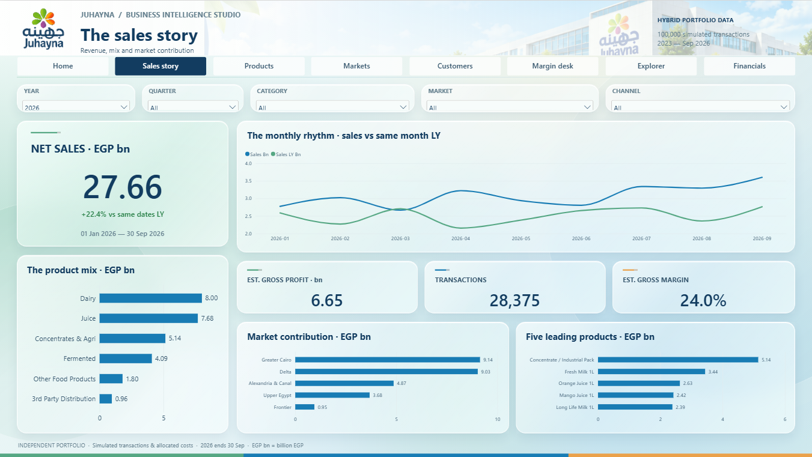

# Juhayna Studio

### From shelf to strategy.

**An editable Power BI portfolio connecting sales, products, markets, customers, margins, and reported financial periods.**

  

---

## About the project

Juhayna Studio is an independent portfolio project that turns a hybrid sales workbook into a connected analytical story. The report is designed for people who need to move from a high-level performance question to the product, market, customer, or transaction detail behind it.

The design uses a light palette, readable typography, and consistent glass-inspired surfaces. Data visuals, tables, slicers, and measures remain native and editable Power BI objects. The decorative glass backplates are image resources.

> **Data note:** This is not an official Juhayna dashboard or an internal company dataset. Transactions, customers, and operating allocations are simulated for portfolio use. Financial figures are retained from the supplied workbook and have not been independently audited. See [Data & methodology](#data--methodology) before interpreting results.

## Report at a glance

| | |
| :--- | :--- |
| **Report pages** | 9 |
| **Data-model tables** | 9 |
| **Relationships** | 5 single-direction relationships |
| **DAX measures** | 80 |
| **Native DAX checks** | 15 passed |
| **Native page checks** | 9 passed |
| **Coverage** | 2023–2026; 2026 ends on 30 September |

## The business questions

| Page | Question it answers |
| :--- | :--- |
| **Home** | Where should I start? A guided entry point to the report. |
| **Sales story** | How are sales trending against the same period last year? |
| **Products** | Which categories and products shape the sales mix? |
| **Markets** | Where does revenue come from, and how do regions compare? |
| **Customers** | Who drives demand, and how concentrated is the customer base? |
| **Margin desk** | How do gross profit, costs, discounts, and returns compare? |
| **Explorer** | Which transactions sit behind the totals? |
| **Financials** | What do the workbook's reported financial periods show? |
| **Data notes** | What is simulated, allocated, reported, or excluded? |

The main analysis pages use synchronized business filters for year, quarter, category, market, and channel. The Financials page keeps its own financial-period selection so reported annual and interim periods are not accidentally combined.

## Open the project

### Option 1 — View the embedded data

Download or clone the repository, then open [Juhayna_Studio.pbix](Juhayna_Studio.pbix) in a recent version of Power BI Desktop.

The PBIX contains the imported data and can be explored without refreshing the source. To navigate between pages in edit mode, use **Ctrl + Click** on the report's navigation buttons.

### Option 2 — Edit the report and model

1. Download or clone the repository.
2. Open [Juhayna_Studio.pbip](Juhayna_Studio.pbip) in Power BI Desktop.
3. Keep `Juhayna.Report` and `Juhayna.SemanticModel` in the same folder as the PBIP.
4. Before refreshing, set the `WorkbookPath` parameter to the full local path of the workbook in [`data/`](data/).
5. Apply the parameter, then refresh.

For a short walkthrough, open [START_HERE.html](START_HERE.html).

## Model and calculations

The model removes five unused source tables, 24 unnecessary columns, and seven measures tied to unused default targets or irrelevant data. The final model keeps nine tables, five single-direction relationships, and 80 measures.

Key calculations include:

- Sales, gross profit, transactions, and weighted margin.
- Same-period-last-year comparisons using the active date context.
- Product, market, customer, and channel contribution.
- Discount, return, and cost analysis.
- Suppression of overlapping annual and interim totals.
- Reported-period reconciliation against the workbook's financial anchors.

The complete measure definitions are available in [Juhayna_Measures.dax](Juhayna_Measures.dax).

## Data & methodology

| Component | Treatment |
| :--- | :--- |
| **Transactions** | 100,000 simulated records for portfolio analysis. |
| **Products** | 16 illustrative products and categories. |
| **Customers** | 350 fictional customers. |
| **Markets and channels** | Illustrative allocations for exploration and filter testing. |
| **COGS and gross profit** | Analytical allocations, not observed product-level profitability. |
| **Workbook financials** | Retained as supplied; not independently audited. |
| **2026 coverage** | Ends on 30 September 2026. No Q4 transactions were fabricated. |
| **Annual and interim periods** | Kept separate to prevent double counting. |

The source workbook's 9M2025 figure overlaps its annual data and does not reconcile with the simulated January–September transactions. The report preserves the reported figure rather than forcing an artificial reconciliation.

The original source workbook was not modified.

## Repository contents

| File / folder | Purpose |
| :--- | :--- |
| [`Juhayna_Studio.pbix`](Juhayna_Studio.pbix) | Ready-to-open report with embedded data. |
| [`Juhayna_Studio.pbip`](Juhayna_Studio.pbip) | Editable Power BI project entry point. |
| [`Juhayna.Report/`](Juhayna.Report/) | Native report definitions and visual resources. |
| [`Juhayna.SemanticModel/`](Juhayna.SemanticModel/) | Model definitions, relationships, and measures. |
| [`Juhayna_Measures.dax`](Juhayna_Measures.dax) | Portable copy of the 80 DAX measures. |
| [`data/`](data/) | Hybrid sample workbook. |
| [`Native_Screenshots/`](Native_Screenshots/) | Actual captures of all nine pages from Power BI Desktop. |
| [`START_HERE.html`](START_HERE.html) | Short opening and refresh guide. |
| [`Delivery_Validation.json`](Delivery_Validation.json) | Final model and delivery validation summary. |

Machine-local `.pbi` cache and settings folders are excluded from version control.

## Validation

Validation was performed against the saved PBIX and native model, including DAX execution and page-by-page UI checks.

- All **80 DAX measures** execute.
- **15 native DAX checks** pass.
- **9 native page checks** pass.
- No fabricated Q4 2026 transactions are present.
- All report resources are present in the packaged PBIX.

Detailed results are included in [`Native_DAX_Test_Results.json`](Native_DAX_Test_Results.json), [`Native_UI_Test_Results.json`](Native_UI_Test_Results.json), and [`Delivery_Validation.json`](Delivery_Validation.json).

## Connect

Built by **Mohamed Mahmoud** — Data Analyst, Cairo, Egypt.

Independent portfolio project. Not commissioned by, endorsed by, or affiliated with Juhayna or any featured brand.
